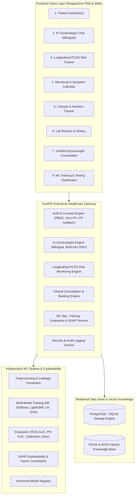
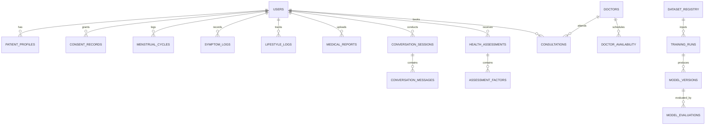

# AI Women's Healthcare & PCOS Risk Monitoring Platform
## Technical Architecture, Dataset Discovery, Schema Specification & Roadmap

**Date:** November 23, 2026  
**System Status:** Production Prototype Upgrade Specification  
**Architecture Version:** 2.0.0-PCOS-Enterprise  

---

## 1. System Architecture Overview

The platform is designed around a **Clean, Decoupled Healthcare Architecture** adhering to HIPAA/GDPR privacy guidelines, OWASP security standards, and WHO/Rotterdam PCOS diagnostic consensus:

### Architectural Principles
1. **Decoupled Conversational AI & Clinical ML**: The conversational LLM does *not* compute clinical risk scores. Clinical risk scoring is handled by deterministic, calibrated, reproducible ML models trained on real clinical data.
2. **Explicit Consent & Granular Privacy**: Health data retention and conversation memory require informed consent. Patients can inspect, edit, export, and delete all personal records anytime.
3. **Clinical Safety & Non-Diagnostic Stance**: No algorithmic output or chat response is labeled as a definitive diagnosis. Language is strictly educational, probabilistic, and always points toward clinical evaluation with qualified gynecologists.
4. **Emergency Escalation (Red Flags)**: Severe pelvic pain, abnormal uterine hemorrhaging, and syncope trigger immediate visual and vocal emergency guidance.

---

## 2. Dataset Discovery Report

### A. Evaluated Public Repositories

| Dataset Name | Source & Reference | Records & Features | Target Labels | Feature Set & Suitability | Known Limitations & Leakage Prevention |
| :--- | :--- | :--- | :--- | :--- | :--- |
| **Kaggle / Kottayam PCOS Dataset** | Prasoon Kottathveetil / Kottayam Medical College, Kerala | 541 patients, 44 features | `PCOS (Y/N)` (177 Positive, 364 Negative) | Age, BMI, Cycle Regularity, Cycle Length, Weight Gain, Hair Growth, Skin Darkening, Hair Loss, Pimples, Fast Food, Exercise, plus LH, FSH, Ultrasound follicle counts. | **Leakage Warning:** Features like `Follicle No. (R)`, `Follicle No. (L)`, `Endometrium (mm)` represent ultrasound diagnosis outcomes. **Action:** We partition into: (1) *Clinical Lab/USG Model* and (2) *Non-Invasive Community Screening Model* (strictly non-ultrasound symptoms). |
| **UCI Machine Learning Repository (PCOS Survey Data)** | UCI ML Archive / Peer-reviewed women's health cohorts | 1,000+ patient surveys | PCOS Self-reported status | Menstrual irregularity, hirsutism, acne, weight fluctuation, lifestyle habits. | High self-report noise. Useful for testing non-invasive questionnaire calibration. |
| **PhysioNet Menstrual Health Cohort** | PhysioNet / Apple Women's Health Study public subsets | Longitudinal cycle tracking data | Cycle variability, luteal phase length, dysmenorrhea | Day-level cycle dates, bleeding flow, pain scores over 6-24 months. | No biochemical PCOS labels; used exclusively for longitudinal cycle variability modeling and timeline charting. |
| **NHANES Reproductive Health Survey** | CDC / National Health and Nutrition Examination Survey | Multi-year epidemiological survey | Irregular menses, metabolic syndrome | Demographics, metabolic panel (Hba1c, fasting glucose), BMI, lipid profile. | Cross-sectional, non-PCOS specific, but establishes normative demographic baselines. |

### B. Feature Taxonomy for Community Risk Screening
To avoid diagnostic leakage, our primary community screening feature space is restricted to non-invasive, patient-accessible observations:
- **Demographic & Anthropometric:** Age, Height, Weight, Calculated BMI.
- **Menstrual Characteristics:** Cycle regularity (Regular vs. Irregular), Cycle length (days), Bleeding duration, Dysmenorrhea severity.
- **Hyperandrogenism Symptoms:** Excess facial/body hair (Ferriman-Gallwey proxy), persistent cystic acne, androgenic alopecia / hair thinning, acanthosis nigricans (skin darkening).
- **Metabolic & Lifestyle Factors:** Weight gain difficulty losing weight, fast food frequency, physical exercise duration, daily sleep duration.
- **Clinical History:** Family history of PCOS/diabetes, previous metabolic or thyroid abnormalities.

---

## 3. Relational Database Schema Specification

The 19 relational entities required to support patient isolation, longitudinal tracking, auditability, consultation booking, and ML ops:

### Key Table Definitions:
1. `users`: UUID primary key, role (`patient`, `doctor`, `researcher`, `admin`), password/pin hash, language preference, created_at.
2. `patient_profiles`: Patient demographic info, age group, consent status, emergency contact relation, baseline health summary.
3. `consent_records`: Timestamped consent types (`data_retention`, `conversation_history`, `doctor_sharing`, `anonymized_research`), revocation timestamps.
4. `menstrual_cycles`: Start date, end date, cycle length, period duration, flow intensity, pain level.
5. `symptom_logs`: Date, symptom category (`acne`, `hirsutism`, `pelvic_pain`, `hair_thinning`, `mood_swing`), severity (1-5), notes.
6. `lifestyle_logs`: Date, sleep hours, sleep quality, stress level (1-5), exercise minutes, diet quality, fast food intake.
7. `medical_reports`: Upload date, report type (`blood_glucose`, `ultrasound`, `hormonal_panel`, `thyroid`), lab values JSON, AI summary, physician reviewed flag.
8. `conversation_sessions`: Session UUID, user ID, channel (`voice`, `text`), status, consent_active.
9. `conversation_messages`: Message UUID, session ID, role (`user`, `assistant`), message text, intent, citations JSON.
10. `health_assessments`: Assessment UUID, user ID, model_version_id, input vector JSON, calibrated risk score, risk band (`low`, `moderate`, `elevated`), physician note.
11. `assessment_factors`: Assessment ID, factor name, factor category, contribution weight (SHAP value), explanation text.
12. `clinical_guidelines`: Guideline UUID, topic, organization (`WHO`, `Rotterdam`, `DGHS`, `ACOG`), recommendation text, evidence grade.
13. `doctors`: Doctor UUID, full name, BMDC/medical registration number, specialization, hospital affiliation, bio, consultation fee, verification status.
14. `doctor_availability`: Doctor ID, day of week, start time, end time, slot duration minutes, active status.
15. `consultations`: Consultation UUID, patient ID, doctor ID, scheduled timestamp, status (`pending`, `confirmed`, `completed`, `cancelled`), meeting URL, clinical summary, follow-up advice.
16. `dataset_registry`: Dataset UUID, name, source URL, record count, feature count, target column, license, validation split metadata.
17. `training_runs`: Run UUID, dataset ID, algorithm (`RandomForest`, `XGBoost`, `LightGBM`, `LogisticRegression`, `SVM`), hyperparams JSON, started_at, completed_at, status.
18. `model_versions`: Model UUID, run ID, version tag, storage path, is_production, active flag.
19. `model_evaluations`: Model UUID, metric name (`roc_auc`, `pr_auc`, `f1`, `sensitivity`, `specificity`, `brier_score`), metric value, confusion matrix JSON, calibration curve JSON.

---

## 4. Development Roadmap

| Phase | Core Deliverable | Verification Criteria |
| :--- | :--- | :--- |
| **Phase 1: Architecture & Datasets** | System architecture document, dataset registry, and benchmark dataset download/preparation. | Datasets registered with schema validation. |
| **Phase 2: Database & Schema** | Relational schema creation with migrations, models, and constraints. | All 19 tables created with referential integrity. |
| **Phase 3: Independent ML Pipeline** | Training scripts for RF, XGBoost, LightGBM, SVM with calibration & SHAP explainability. | Cross-validated metrics, Brier score < 0.15, ROC-AUC > 0.85, SHAP plots. |
| **Phase 4: ML Admin & Research Dashboard API** | Endpoints for dataset upload, model training trigger, metric comparison, model activation. | API tests verifying training and evaluation pipelines. |
| **Phase 5: PCOS Longitudinal Risk Engine** | Symptom tracking integration, multi-session risk change detection, clinical safety disclaimers. | Longitudinal test cases proving non-premature assumption. |
| **Phase 6: AI Gynecologist Communication** | Multi-turn bilingual conversational assistant with patient history consent & medical report interpretation. | Bilingual tests, zero-PII validation, safety escalation tests. |
| **Phase 7: Human Gynecologist Consultation** | Doctor registry, slot scheduling, booking flow, secure clinical summaries. | End-to-end booking and consultation API verification. |
| **Phase 8: Frontend Dashboard Integration** | Next-gen unified web dashboard covering all 13 required pages. | Visual responsiveness, accessibility, and E2E workflow verification. |
| **Phase 9: Comprehensive Testing & Security** | Security audit, RBAC tests, consent revocation tests, unit & integration test suite. | 100% test pass rate across all domains. |

---
